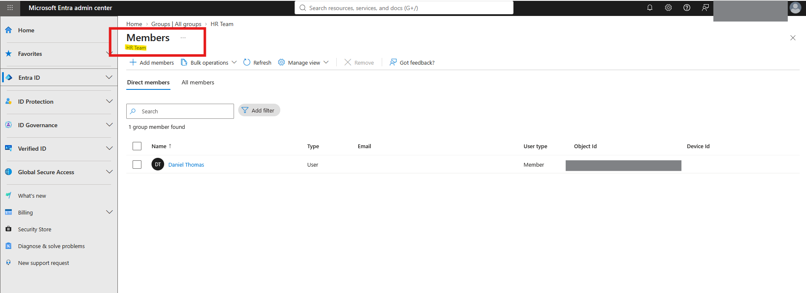
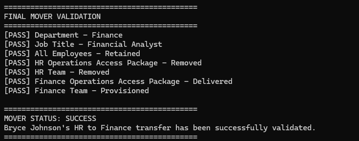
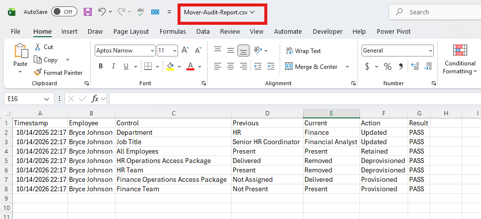

# Microsoft Entra ID Employee Mover Automation

## Overview

This project demonstrates an automated **Mover workflow** within the
Joiner-Mover-Leaver (JML) identity lifecycle using **Microsoft Entra ID,
Microsoft Graph PowerShell, and Microsoft Entra Entitlement
Management**.

The scenario simulates an existing employee transferring internally from
**HR to Finance**. The automation updates the employee's identity
attributes, removes access associated with the previous HR role,
provisions governed Finance access, retains required baseline access,
and independently validates the employee's final identity and
authorization state.

The project was designed around a key IAM principle:

> **A department transfer should change both who the employee is within
> the directory and what the employee is authorized to access.**

Rather than simply adding Finance access, the workflow verifies that
obsolete HR access has been removed before allowing Finance provisioning
to continue. This helps prevent **access accumulation and privilege
creep** during internal employee transfers.

The automation also generates pre-change, post-change, and audit reports
to provide evidence of the identity and access changes performed during
the Mover transaction.

------------------------------------------------------------------------

## Business Scenario

**Employee:** Bryce Johnson\
**Mover Event:** Internal transfer from HR to Finance

### Before the Move

| Attribute / Access | State |
|---|---|
| Department | HR |
| Job Title | Senior HR Coordinator |
| Account Status | Enabled |
| All Employees | Retained baseline access |
| HR Operations Access Package | Assigned |
| HR Team | Provisioned through Entitlement Management |
| Finance Operations Access Package | Not assigned |
| Finance Team | Not provisioned |

### Target State

| Attribute / Access | Required State |
|---|---|
| Department | Finance |
| Job Title | Financial Analyst |
| Account Status | Remains enabled |
| All Employees | Retained |
| HR Operations Access Package | Removed |
| HR Team | Removed |
| Finance Operations Access Package | Delivered |
| Finance Team | Provisioned |

Because this is a **Mover** event rather than a Leaver event, the
employee's Entra ID account remains active and existing sign-in sessions
are not revoked as part of the workflow.

------------------------------------------------------------------------

## Project Objectives

The automation was designed to:

-   Process an HR-driven employee transfer from a CSV input file.
-   Validate the employee's existing identity state before making
    changes.
-   Discover the employee's existing baseline and governed access.
-   Capture the pre-change identity and access state for audit purposes.
-   Update the employee's department and job title through Microsoft
    Graph.
-   Remove obsolete HR access through Microsoft Entra Entitlement
    Management.
-   Verify that HR access has been fully deprovisioned before granting
    Finance access.
-   Provision the Finance Operations Access Package.
-   Verify downstream Finance Team membership.
-   Preserve the employee's required All Employees baseline access.
-   Perform independent final-state validation.
-   Generate post-change and control-level audit reports.
-   Support safe reruns when portions of the Mover transaction have
    already completed.

------------------------------------------------------------------------

## Mover Workflow

``` text
HR Mover Event
      |
      v
CSV Input
      |
      v
Authenticate to Microsoft Graph
      |
      v
Validate Employee Identity
      |
      v
Discover Existing Access
      |
      v
Capture Pre-Change State
      |
      v
Update Identity Attributes
HR -> Finance
Senior HR Coordinator -> Financial Analyst
      |
      v
Remove HR Operations Access Package
      |
      v
Entitlement Management Deprovisions HR Team
      |
      v
Verify Previous HR Access Is Removed
      |
      v
Access-Overlap Control
      |
      v
Assign Finance Operations Access Package
      |
      v
Entitlement Management Provisions Finance Team
      |
      v
Verify Finance Access
      |
      v
Final Identity + Access Validation
      |
      v
MOVER STATUS: SUCCESS
      |
      v
Generate Post-Change + Audit Reports
```

A critical control prevents Finance access from being provisioned until
obsolete HR access has been successfully removed and verified. This
sequencing supports **least privilege** and reduces access accumulation
during the role change.

------------------------------------------------------------------------

## Technologies Used

| Technology | Purpose |
|---|---|
| Microsoft Entra ID | Identity directory and access platform |
| Microsoft Entra Entitlement Management | Governed Access Package provisioning and deprovisioning |
| Microsoft Graph PowerShell SDK | Identity and entitlement automation |
| PowerShell | Workflow orchestration, validation, error handling, and reporting |
| Microsoft Graph API | Programmatic identity and entitlement operations |
| CSV | Simulated authoritative HR mover event |
| Entra Security Groups | Baseline and departmental resource access |
| Git / GitHub | Source control and portfolio documentation |

## Identity and Access Model

The project separates **baseline access** from **role-specific governed
access**.

### Baseline Access --- All Employees

`All Employees` represents access that should remain with the employee
regardless of the departmental transfer. The Mover automation verifies
that this membership is retained.

### HR Governed Access

The `HR Operations Access Package` contains the `HR Team` security group
as a governed resource.

Removing the Access Package assignment allows **Entitlement Management
to deprovision HR Team access**, rather than having the automation
directly manipulate the governed security group.

### Finance Governed Access

The `Finance Operations Access Package` contains the `Finance Team`
security group as a governed resource.

When the Finance Access Package is assigned, **Entitlement Management
provisions the employee into Finance Team**.

This design allows the automation to operate at the entitlement layer
while Microsoft Entra handles the underlying resource provisioning.

------------------------------------------------------------------------

## Implementation

### 1. HR Mover Input

The workflow begins with a CSV file that simulates an authoritative
mover event received from an HR system.

``` csv
UserPrincipalName,CurrentDepartment,NewDepartment,CurrentJobTitle,NewJobTitle
bryce.johnson@contoso.com,HR,Finance,Senior HR Coordinator,Financial Analyst
```

Including both current and target values allows the automation to verify
that the employee is in an expected state before processing the
transfer.

------------------------------------------------------------------------

### 2. Pre-Move Identity Validation

Before making changes, the automation retrieves the employee from
Microsoft Entra ID and validates the current department and job title
against the HR mover input.


The PowerShell validation confirms that the employee exists and that the
directory attributes match the expected source state.


If the identity is in neither the expected pre-move state nor the
expected target state, processing stops. The automation also recognizes
when the employee is already in the target state, making the
identity-update portion **rerun-safe**.

------------------------------------------------------------------------

### 3. Existing Access Discovery

The workflow checks for:

-   Membership in the `All Employees` baseline security group.
-   A delivered `HR Operations Access Package` assignment.

Before the move, the employee has governed HR access:


The Access Package contains `HR Team` as a governed resource:


PowerShell confirms the employee's current baseline and governed access
before continuing:


------------------------------------------------------------------------

### 4. Pre-Change Evidence

Before modifying the identity, the automation generates:

``` text
Reports/Mover-PreChange-Report.csv
```

The report records the employee's identity and access state before the
transaction. The original pre-change report is preserved on subsequent
executions instead of being overwritten with the employee's new state.

This provides a stable **before-state audit record** even when the
automation is rerun.

------------------------------------------------------------------------

### 5. Identity Attribute Update

Microsoft Graph updates:

``` text
Department: HR -> Finance
Job Title: Senior HR Coordinator -> Financial Analyst
```

The automation retrieves the identity again and independently verifies
the target values.


The resulting Entra ID profile reflects the new organizational role:


Updating identity attributes alone does **not** complete the Mover
transaction. Authorization must also change to match the new role.

------------------------------------------------------------------------

### 6. HR Access Deprovisioning

The workflow removes the delivered `HR Operations Access Package`
assignment using an administrative Entitlement Management removal
request.

The automation does not directly remove the employee from `HR Team`:

``` text
Remove HR Operations Access Package
                |
                v
Microsoft Entra Entitlement Management
                |
                v
Deprovision HR Team Resource Access
```

After submitting the removal request, the automation independently
verifies that both the entitlement and resulting resource access have
been removed.


The resulting group membership confirms that the employee no longer
retains HR Team access:



------------------------------------------------------------------------

### 7. Access-Overlap Protection

Finance provisioning is allowed to continue only when both conditions
are satisfied:

``` text
HR Operations Access Package = Removed
HR Team                       = Removed
```

If either condition fails, the workflow stops.

``` text
Old HR Access Removed?
        |
    +---+---+
    |       |
   NO      YES
    |       |
   STOP     v
       Provision Finance Access
```

This control helps prevent the employee from accumulating access
associated with both departmental roles.

------------------------------------------------------------------------

### 8. Finance Access Provisioning

Once obsolete HR access is verified as removed, the automation locates
the existing `Finance Operations Access Package` and its assignment
policy, then submits an administrative assignment request through
Entitlement Management.

``` text
Finance Operations Access Package
                |
                v
Microsoft Entra Entitlement Management
                |
                v
Finance Team Membership
```

The automation verifies both the entitlement and resulting resource
access.


The final group membership confirms provisioning into Finance Team:


Finance provisioning must be fully verified before final validation can
proceed.

------------------------------------------------------------------------

### 9. Final Mover Validation

The automation performs a fresh validation rather than assuming
previously submitted operations succeeded.

| Final Control | Required State |
|---|---|
| Department | Finance |
| Job Title | Financial Analyst |
| All Employees | Retained |
| HR Operations Access Package | Removed |
| HR Team | Removed |
| Finance Operations Access Package | Delivered |
| Finance Team | Provisioned |

Only when every control passes does the automation return:

``` text
MOVER STATUS: SUCCESS
```



------------------------------------------------------------------------

## Audit and Reporting

The automation produces three CSV reports:

-   **Mover-PreChange-Report.csv** --- captures identity and access
    before the transfer.
-   **Mover-PostChange-Report.csv** --- captures the independently
    verified final state.
-   **Mover-Audit-Report.csv** --- provides a control-level record of
    changes and PASS/FAIL results.

| Control | Previous State | Current State | Action |
|---|---|---|---|
| Department | HR | Finance | Updated |
| Job Title | Senior HR Coordinator | Financial Analyst | Updated |
| All Employees | Present | Present | Retained |
| HR Operations Access Package | Delivered | Removed | Deprovisioned |
| HR Team | Present | Removed | Deprovisioned |
| Finance Operations Access Package | Not Assigned | Delivered | Provisioned |
| Finance Team | Not Present | Present | Provisioned |



Together, the reports provide **before-state evidence, after-state
evidence, and a control-level audit trail**.

------------------------------------------------------------------------

## Security & IAM Controls Demonstrated

### Least Privilege and Access-Creep Prevention

The employee receives access required for the new Finance role while
obsolete HR access is removed. The workflow does not treat a transfer as
simply an opportunity to add more access.

Finance provisioning is blocked until HR deprovisioning is verified.

### Governed Access

Departmental access is managed through Microsoft Entra Entitlement
Management rather than direct manipulation of the governed departmental
groups.

``` text
HR Operations Access Package
        |
        +--> HR Team

Finance Operations Access Package
        |
        +--> Finance Team
```

### Baseline Access Preservation

`All Employees` represents baseline organizational access that should
survive the transfer. The workflow verifies that this membership remains
present.

### Separation of Identity and Authorization Validation

A successful department or job-title update does not prove that
authorization changed correctly. Identity attributes and access are
therefore validated independently.

### Fail-Closed Workflow Controls

The workflow stops when critical state verification fails. Examples
include:

-   Finance provisioning is blocked if HR deprovisioning cannot be
    verified.
-   Final validation does not proceed if required Finance access cannot
    be verified.
-   Unexpected identity states stop processing rather than forcing an
    update.

### Independent Post-Change Verification

The automation distinguishes between:

``` text
Request Submitted
```

and:

``` text
Desired State Verified
```

The workflow only returns `MOVER STATUS: SUCCESS` after all required
final-state controls pass.

### Auditability

Pre-change state, post-change state, individual control results,
actions, and PASS/FAIL outcomes are recorded to provide evidence of the
Mover transaction.

------------------------------------------------------------------------

## Errors & Troubleshooting

### Microsoft Graph Assignment Policy Retrieval Error

One of the primary technical issues occurred while retrieving the
assignment policy associated with the
`Finance Operations Access Package`.

#### Problem

The initial implementation attempted to retrieve the Access Package
assignment policy through an assignment-policy request using the Access
Package ID. The request returned an API resource error indicating that
the requested assignment-policy resource path could not be found.

This prevented the automation from obtaining the policy ID required to
submit the Finance Access Package assignment.

#### Investigation

The Finance Access Package itself could be retrieved successfully, which
isolated the problem to the assignment-policy retrieval method.

Instead of treating the policy as a separate nested resource through the
failing request path, the troubleshooting process tested retrieving the
Access Package while expanding its `assignmentPolicies` relationship.

#### Solution

The working implementation retrieves the Finance Access Package and
expands the associated policies:

``` powershell
$FinancePackageWithPolicies = Get-MgEntitlementManagementAccessPackage `
    -AccessPackageId $FinanceAccessPackage.Id `
    -ExpandProperty "assignmentPolicies" `
    -ErrorAction Stop
```

The required policy is then selected from the returned relationship:

``` powershell
$FinanceAssignmentPolicy = $FinancePackageWithPolicies.AssignmentPolicies |
    Where-Object { $_.DisplayName -eq "Initial Policy" } |
    Select-Object -First 1
```

After retrieving the correct policy ID, the automation successfully
submitted the Finance Access Package assignment request.

#### Lesson

Microsoft Graph PowerShell cmdlet behavior may require understanding the
underlying Graph resource relationships rather than relying only on
cmdlet naming or an assumed resource hierarchy.

------------------------------------------------------------------------

## Lessons Learned

### 1. A Successful API Request Does Not Guarantee a Completed Access Change

Entitlement Management operations can require time to process. The
automation therefore verifies both the **entitlement state** and
**resulting resource membership** before considering provisioning or
deprovisioning successful.

### 2. Mover Workflows Must Remove Access, Not Just Add It

A secure Mover process must answer three questions:

``` text
What access should remain?
What access should be removed?
What new access should be granted?
```

HR deprovisioning is therefore a required control rather than an
optional cleanup step.

### 3. Access Sequencing Matters

The project uses:

``` text
Remove Old Access
       |
       v
Verify Removal
       |
       v
Provision New Access
       |
       v
Verify Provisioning
```

This sequencing supports least privilege and reduces access
accumulation.

### 4. Identity State and Access State Are Different

Changing `Department = Finance` does not prove that HR access was
removed or Finance access was provisioned. Identity attributes and
authorization must be validated independently.

### 5. Lifecycle Automation Should Be Rerun-Safe

During development and testing, an employee may already be in the target
state when the script is executed again. The automation recognizes both
the expected pre-move state and expected target state, allowing
completed identity operations to be skipped safely.

The original pre-change report is also preserved during reruns.

### 6. Governed Access Should Be Managed Through the Governing Entitlement

Because `HR Team` and `Finance Team` are governed by their respective
Access Packages, the automation changes the Access Package assignment
and allows Entitlement Management to provision or deprovision the
underlying resource.

### 7. Final Validation Should Be Independent

The final validation does not assume earlier steps succeeded simply
because they executed without throwing an exception. Fresh queries are
used to evaluate the employee's final state.

------------------------------------------------------------------------

## Production Considerations

This project was developed as a controlled Microsoft Entra ID lab and
portfolio demonstration. A production implementation would require
additional controls.

### Authoritative HR Integration

The lab uses CSV input to simulate an HR-generated Mover event. A
production workflow would ideally originate from an authoritative HR
system or identity governance process.

### Authentication and Automation Identity

The lab uses interactive Microsoft Graph authentication with delegated
permissions. Production automation should use an appropriately secured
workload identity, such as a service principal or managed identity where
supported, with only the permissions required.

### Least-Privilege Microsoft Graph Permissions

Production implementations should evaluate each API operation and reduce
Graph permissions to the minimum necessary.

### Dynamic Policy and Entitlement Discovery

The lab uses known Access Package and policy names. Production
automation should favor controlled configuration, stable identifiers, or
an external configuration source where appropriate.

### Provisioning Polling and Retry Logic

The lab uses a short wait before verifying Entitlement Management
operations. Production automation should use controlled polling, retry
logic, and a maximum timeout.

``` text
Submit Request
      |
      v
Check State
      |
      +---- Not Ready ----> Wait ----> Retry
      |
     Ready
      |
      v
Continue Workflow
```

### Centralized Logging and Monitoring

Production lifecycle events should be sent to centralized logging or
security monitoring platforms for retention, correlation, alerting, and
review.

### Failure Handling and Recovery

Production automation should include structured exception handling,
transient-error retries, clear failure states, alerting, recovery
procedures, and administrative review for incomplete transactions.

### Approval and Governance Requirements

Sensitive Finance entitlements may require manager, resource-owner, or
security approval rather than automatic administrative assignment.

### Separation of Duties

Higher-risk transfers may require Separation of Duties checks to
identify incompatible access combinations before new access is
provisioned.

### Scalable Multi-Employee Processing

Large-scale processing would benefit from transaction-level logging,
per-user failure isolation, batch controls, and summary reporting.

------------------------------------------------------------------------

## Prerequisites

The lab assumes the following resources already exist:

### Microsoft Entra ID

-   Microsoft Entra tenant with licensing required for Entitlement
    Management.
-   Test employee account representing the Mover identity.
-   `All Employees` baseline security group.
-   `HR Team` security group.
-   `Finance Team` security group.

### Entitlement Management

-   `HR Operations Access Package` in the HR Operations Catalog with
    `HR Team` as a governed resource.
-   `Finance Operations Access Package` in the Finance Operations
    Catalog with `Finance Team` as a governed resource.
-   An assignment policy for the Finance Operations Access Package.

The Mover script does not create catalogs, Access Packages, security
groups, or assignment policies. These resources represent the
organization's existing access model.

### PowerShell

The automation requires the Microsoft Graph PowerShell SDK and
permissions sufficient to read/update users, read group membership, work
with Entitlement Management resources, and submit Access Package
assignment/removal requests.

------------------------------------------------------------------------

## How to Run

### 1. Prepare the Mover Input

Update:

``` text
Input/Mover-Input.csv
```

Example:

``` csv
UserPrincipalName,CurrentDepartment,NewDepartment,CurrentJobTitle,NewJobTitle
bryce.johnson@contoso.com,HR,Finance,Senior HR Coordinator,Financial Analyst
```

### 2. Review the Existing Access Model

Confirm that:

-   The employee has the expected baseline access.
-   The employee has the expected current departmental Access Package.
-   The target departmental Access Package exists.
-   The required assignment policy exists.
-   The Access Packages contain the appropriate governed resources.

### 3. Open PowerShell

Navigate to the project directory:

``` powershell
cd C:\Path\To\Entra-ID-Employee-Mover-Automation
```

### 4. Run the Automation

``` powershell
.\Scripts\Invoke-EmployeeMover.ps1
```

### 5. Review Final Validation

A successful transaction should end with:

``` text
[PASS] Department - Finance
[PASS] Job Title - Financial Analyst
[PASS] All Employees - Retained
[PASS] HR Operations Access Package - Removed
[PASS] HR Team - Removed
[PASS] Finance Operations Access Package - Delivered
[PASS] Finance Team - Provisioned

MOVER STATUS: SUCCESS
```

### 6. Review Audit Evidence

Review:

``` text
Reports/Mover-PreChange-Report.csv
Reports/Mover-PostChange-Report.csv
Reports/Mover-Audit-Report.csv
```

------------------------------------------------------------------------

## Repository Structure

``` text
Entra-ID-Employee-Mover-Automation/
│
├── Input/
│   └── Mover-Input.csv
│
├── Reports/
│   ├── Mover-PreChange-Report.csv
│   ├── Mover-PostChange-Report.csv
│   └── Mover-Audit-Report.csv
│
├── Screenshots/
│   ├── 01-Bryce-Pre-Move-Profile.png
│   ├── 02-Bryce-HR-Access-Package.png
│   ├── 03-HR-Access-Package-Resources.png
│   ├── 04-Bryce-HR-Team-Membership.png
│   ├── 05-Finance-Access-Package-Resources.png
│   ├── 06-PowerShell-Pre-Move-Validation.png
│   ├── 07-PowerShell-Pre-Move-Access-Discovery.png
│   ├── 08-PowerShell-Identity-Update.png
│   ├── 09-Bryce-Post-Move-Profile.png
│   ├── 10-PowerShell-HR-Deprovisioning-Verification.png
│   ├── 11-Bryce-HR-Team-Removed.png
│   ├── 12-PowerShell-Finance-Provisioning-Verification.png
│   ├── 13-Bryce-Finance-Team-Membership.png
│   ├── 14-Final-Mover-Validation.png
│   └── 15-Mover-Audit-Report.png
│
├── Scripts/
│   └── Invoke-EmployeeMover.ps1
│
└── README.md
```

Screenshots 04 and 05 remain in the repository as supporting evidence
even though they are not embedded in the main README.

------------------------------------------------------------------------

## Project Scope

This repository is a **lab and portfolio project** created to
demonstrate Microsoft Entra ID identity lifecycle automation concepts.

The environment, identities, organizational structure, Access Packages,
security groups, and employee transfer scenario are simulated for
demonstration purposes.

The project demonstrates:

-   Joiner-Mover-Leaver lifecycle management
-   Microsoft Entra ID administration
-   Microsoft Graph automation
-   Microsoft Entra Entitlement Management
-   Governed access
-   Identity and authorization validation
-   Least privilege
-   Access-creep prevention
-   Audit reporting
-   PowerShell automation

It is not intended to represent a complete production identity
governance architecture without the additional controls described in
**Production Considerations**.

------------------------------------------------------------------------

## Key Outcome

The completed project demonstrates an end-to-end Microsoft Entra ID
**Mover** workflow that:

-   Updates identity attributes through Microsoft Graph.
-   Preserves required baseline access.
-   Deprovisions obsolete governed access.
-   Prevents access overlap before provisioning a new departmental
    entitlement.
-   Provisions role-appropriate governed access through Microsoft Entra
    Entitlement Management.
-   Independently verifies identity and authorization changes.
-   Supports rerun-safe processing.
-   Produces pre-change, post-change, and control-level audit evidence.

The project demonstrates how IAM automation can support the **Mover
stage of Joiner-Mover-Leaver lifecycle management while enforcing least
privilege, reducing access creep, and maintaining an auditable record of
identity and access changes.**
